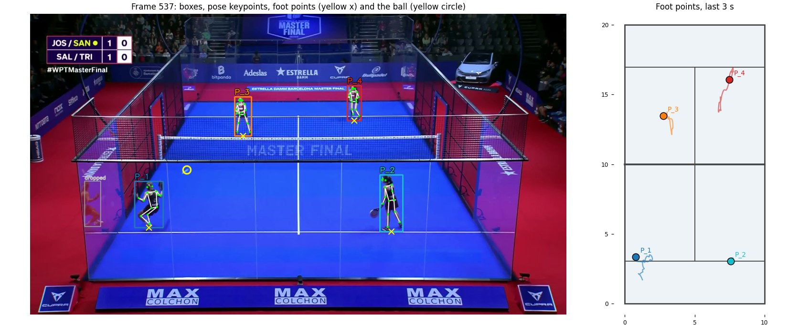
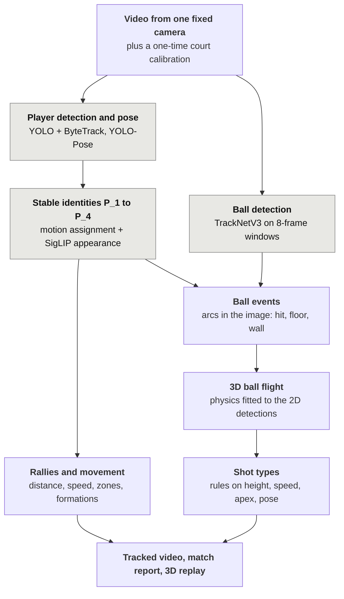
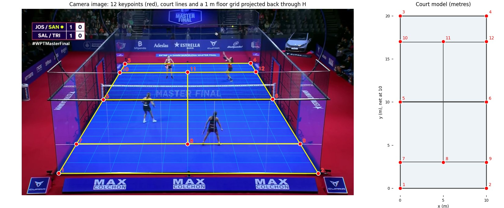
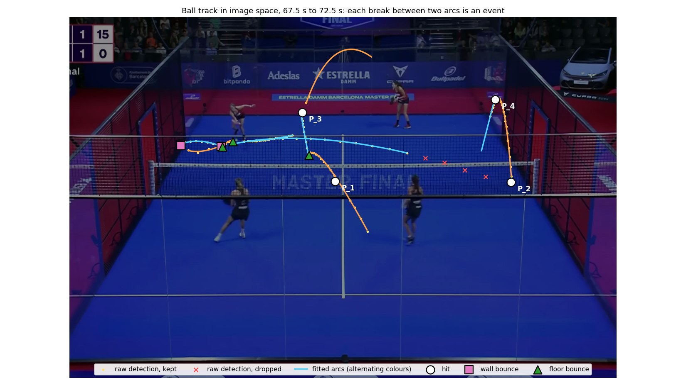
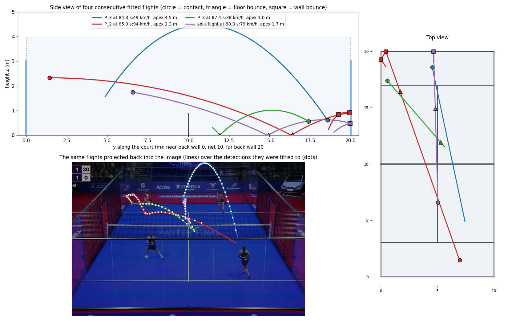
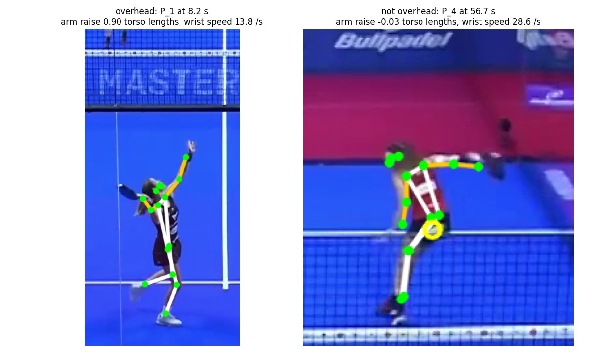
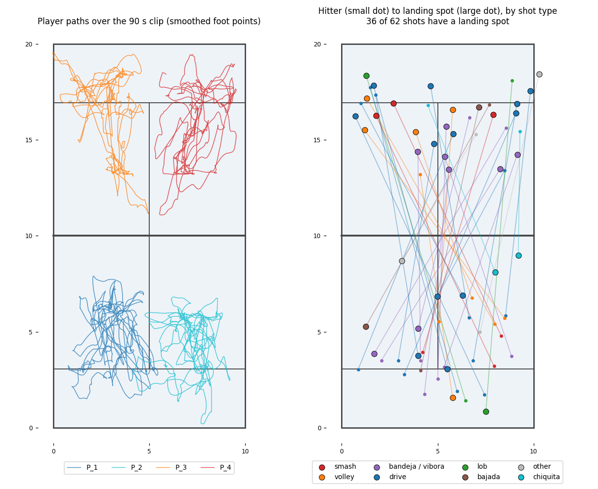

# Padex

Padex turns a padel match video from one fixed camera into player tracks, a 3D
ball path, a list of classified shots, a match report and a 3D replay.

> **padex** = padel + x (analytics/extraction)



## Setup

```bash
git clone https://github.com/stoicescueric/padex.git
cd padex
uv sync --group dev
```

On Windows this installs the CUDA build of PyTorch; a GPU makes tracking many
times faster. The YOLO weights are downloaded to `~/.padex/weights/` on first
use. The fine-tuned ball model is in `checkpoints/padel_tracknetv3.pt`.

## Use

Run everything from the repository folder.

```bash
# 1. Once per camera position: click the court keypoints.
#    Saves videos/match_calibration.json next to the video.
uv run python -m padex calibrate videos/match.mp4

# 2. Tracking, tracked video, report and 3D replay.
uv run python -m padex run videos/match.mp4
```

Results go to `output/match/`:

| File | What it is |
| --- | --- |
| `match_tracked.mp4` | The video with players, ball, ball speed, bounces and shot types drawn on it |
| `report.html` | The match report: movement, heatmaps, shots, rallies |
| `scene3d.html` | 3D replay of court, players and ball |
| `shots.csv`, `ball_events.csv`, `positions.csv`, `summary.json` | The data behind the report |

`bash run_match.sh videos/match.mp4` does the same and keeps a log in `logs/`.

Tracking is the slow step. Its result is saved next to the video as
`videos/match_tracking_cache.pkl` and reused on later runs, as long as the video, the
calibration, the ball model and the settings are the same. The report and the
replay can be made again from that cache alone, without the video or a GPU:

```bash
uv run python -m padex report videos/match_tracking_cache.pkl --out output/match
uv run python -m padex replay videos/match_tracking_cache.pkl --out output/match/scene3d.html
```

`uv run python -m padex <command> --help` lists the options of each command.
Where Windows lets it run, the shorter `uv run padex ...` is the same thing.

From Python:

```python
from padex import Padex

p = Padex("videos/match.mp4")
p.run()                    # everything, or:
analysis = p.analyse()     # stable player IDs, ball events, 3D ball flights
```

## How it works

Three steps read the video with a neural network; everything after that is
geometry, physics and padel rules working on their results. The figures below
come from a 90-second test clip.



Grey boxes run a neural network on the video. Their output is cached, so the
white boxes can be rerun with other settings without touching the video.

### 1. Court calibration

One 3×3 matrix, the homography H, converts any pixel on the court floor into
court metres. The camera is fixed, so H is fitted once per video, to up to 12
clicked keypoints (`padex calibrate`).

```math
\begin{pmatrix} x' \\ y' \\ w \end{pmatrix} = H \begin{pmatrix} u \\ v \\ 1 \end{pmatrix}, \qquad (x, y) = \left( \frac{x'}{w}, \frac{y'}{w} \right)
```



*The calibration drawn back onto a frame: the 12 keypoints in red, and a grid of 1 m squares on the floor.*

H is only valid on the floor. A player's feet map correctly; a ball in the air
does not, which shapes the two ball steps below.

### 2. Players: detection, pose and stable identities

YOLO with ByteTrack finds the people, YOLO-Pose gives 17 body keypoints each,
and the bottom-centre of each box (the feet) is mapped onto the court. Anyone
more than 1 m outside the court is dropped.

ByteTrack's IDs break at every occlusion and crossing: it gave 15 different IDs
to the four players in the test clip. The identity step
(`analysis/identities.py`) folds them into exactly four. It knows what the
tracker does not: there are four players, two per side, and they move smoothly.
Each frame it predicts where every player should be and solves the assignment
of detections to players with the Hungarian algorithm:

```math
\text{cost} = \lVert p_{\text{det}} - p_{\text{pred}} \rVert \;-\; 0.4\, w_{\text{id}}\,[\text{same tracker ID}] \;+\; 3.0\,[\text{other side of the net}]
```

Afterwards it checks the result against what the players look like (SigLIP
embeddings of body crops) and undoes swaps between players who look different.


*One frame after the identity step: boxes, pose, foot points and the ball. The grey box on the left is a fifth detection that the assignment dropped.*

### 3. Ball detection

TrackNetV3 is a U-Net that looks at a background frame plus 8 consecutive
frames at once and outputs one heatmap per frame. A padel ball is a few blurred
pixels in broadcast footage; seeing it move is what makes it findable. The
weights are fine-tuned on padel (see "The ball model" below).

### 4. Ball events: hits, floor bounces, wall bounces

Between two contacts, a ball in flight traces a smooth curve in the image.
`analysis/ball_events.py` drops stationary detections, links the rest into
tracklets, and splits each tracklet into arcs that fit a quadratic. Wherever
one arc ends and another begins, something touched the ball:

| Event | Rule |
| --- | --- |
| Hit | The break lies within a player's reach |
| Floor bounce | The image track gets a sudden upward kick, and the point maps onto the court |
| Wall bounce | Any other break |



*Five seconds of the ball track. Dots are raw detections and lines the fitted arcs; a marker sits wherever one arc hands over to the next.*

### 5. 3D ball flight from one camera

One camera gives only the direction to the ball, not its distance. But between
contacts the ball obeys known physics, and only one launch produces a path
that, seen from the camera, passes through every detection.
`analysis/ball_flight.py` recovers the full camera from H, then fits a
simulation with gravity, air drag and bounces off the floor and the glass to
each flight between two hits:

```math
\dot{\mathbf{v}} = \mathbf{g} - k\,\lVert \mathbf{v} \rVert\,\mathbf{v}, \qquad k = \frac{\rho\, C_d\, A}{2m} \approx 0.019\ \text{m}^{-1}
```



*Four consecutive fitted flights from the side and from above. Bottom: the same paths projected back into the image pass through the detections they were fitted to.*

This gives every shot a height, a speed and a landing spot, and the ball speed
shown on the tracked video.

### 6. Shot types

Each hit is named by a fixed chain of rules on measured features: serve,
bajada, smash, bandeja/víbora, lob, volley, chiquita, drive
(`analysis/shots.py`). No classifier is trained.

Whether a shot is an overhead comes from the hitter's pose around the hit
(`analysis/swing.py`): an arm raised above its shoulder. The same reading rules
out "hits" by players who stood still while the ball merely passed them in the
image.



*Left: an overhead. Right: a low shot with a fast wrist but no raised arm. Arm raise is measured in torso lengths, so it means the same for near and far players.*

### 7. Rallies, movement and the report

Rallies come from the ball track (or from player movement when the ball is
seen too rarely). `analysis/movement.py` measures distance, speed, sprints, net
and back time and team formations; `report/` writes the HTML report, the data
files and the 3D replay.



*Left: each player's path over the clip. Right: shots drawn from the hitter to where the ball landed, by type.*

Each module's docstring explains its step in full and lists its thresholds.

### Known limits

- Nothing has been checked against hand-labelled ground truth yet; thresholds were set by eye on two clips.
- Rallies are split where the ball is missing for 4 s, which fails on edited footage without pauses.
- Bandeja and víbora are one class; winner and error are guesses from the last flight of a rally.
- The camera must not move, and calibration is manual.

## Layout

```
src/padex/
  pipeline.py          Padex: track -> analyse -> outputs
  cli.py               the padex command (calibrate, run, report, replay)
  court.py             court model and homography
  calibration.py       interactive court calibration
  weights.py           download of the YOLO weights
  schemas/tracking.py  PlayerFrame, BallFrame, CourtCalibration
  io/video.py          video reader and writer
  tracking/            video -> raw tracking (the GPU part)
    player.py            people, tracker IDs, pose
    ball.py              TrackNetV3 ball detector
    pipeline.py          runs both over a video
    cache.py             the tracking cache and its key
  analysis/            raw tracking -> players, shots, statistics
    identities.py        four stable player IDs
    appearance.py        what each player looks like (SigLIP)
    ball_events.py       hits and bounces in 2D
    ball_flight.py       3D ball flights
    swing.py             what the hitter's body did (pose)
    shots.py             shot types and rally endings
    movement.py          movement and formations
    match.py             all of the above for one tracking cache
  report/              match report and 3D replay (with their HTML templates)
  viz/                 drawing on video frames
videos/                your match videos, each with its calibration JSON and caches
tools/                 labelling and training the ball model, checks
tests/
```

## The ball model

The ball detector is TrackNetV3 fine-tuned on padel footage. To improve it on
your own videos:

```bash
uv run python tools/find_gaps.py videos/match.mp4      # where the ball is missed; prints the labelling commands
uv run python tools/label_ball.py videos/match.mp4 --start 1200 --end 1350 --name match_01 --suggest videos/match_tracking_cache.pkl
bash tools/retrain_own.sh match                 # fine-tune on your clips, writes a new checkpoint
BALL_MODEL=checkpoints/padel_tracknetv3_own.pt bash run_match.sh videos/match.mp4
```

`tools/train_padel.sh` is the first fine-tuning, from the original badminton
weights on PadelTracker100. `tools/check_calibration.py` shows which clicked
keypoint hurts a calibration; `tools/audio_hits.py` finds impact sounds in the
audio track (an experiment, not used by the pipeline).

## Settings

| Environment variable | Effect |
| --- | --- |
| `PADEX_TRACKER` | Player tracker config: `padex_bytetrack.yaml` (default) or `padex_botsort.yaml`, or a file of your own |
| `PADEX_FP16=0` | Full precision on the GPU (default: half precision on CUDA) |
| `PADEX_POSE_CLOSEUPS=1` | Pose from close-ups of the players only: faster, slightly worse for the near players |
| `PADEX_THREADS=0` | Run the models one after another on one thread |
| `PADEX_WORKERS` | Processes for the 3D ball fit (default: half the logical CPUs) |

## Development

```bash
uv run pytest
uv run ruff check src tests tools
uv run ruff format src tests tools
```

The tests need no video, no model weights and no GPU.

## Credits and license

Based on [Padex](https://github.com/rondo-labs/Padex) by Xingnan Zhu, of which
the tracking layer, the calibration tool and the frame drawing remain. The ball
model architecture is [TrackNetV3](https://github.com/qaz812345/TrackNetV3).

GPL v3, see [LICENSE](LICENSE).
